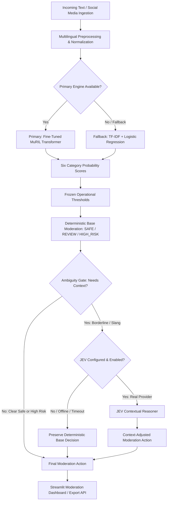

# Multilingual Social Media Toxicity Detection

## 1. Overview

**Multilingual Social Media Toxicity Detection** is an assistive content moderation system engineered to detect toxic, abusive, and harmful language across social media interactions. Social media discourse often blends languages, colloquialisms, and cultural expressions. This system is designed specifically to analyze:

* **English**
* **Hindi** (Devanagari script)
* **Hinglish** (code-mixed Hindi written in Roman script)
* **Colloquial and slang-heavy social media text**

The pipeline evaluates incoming text across six fine-grained toxicity categories and translates model confidence scores into structured, policy-driven moderation tiers (`SAFE`, `REVIEW`, `HIGH_RISK`).

> **Assistive System Notice:** This system is built to assist and accelerate human moderation workflows, not to replace human judgment. It surfaces high-risk content for immediate intervention and flags ambiguous cases for human review.

---

## 2. Key Features

* **MuRIL Primary Engine:** Leverages Google's pretrained MuRIL transformer (`google/muril-base-cased`), fine-tuned specifically for cross-lingual representations covering Indian languages and transliterated text.
* **Six-Label Multi-Label Classification:** Simultaneously predicts probabilities for `toxic`, `severe_toxic`, `obscene`, `threat`, `insult`, and `identity_hate`.
* **Logistic Regression + TF-IDF Fallback Engine:** A fast, resource-light fallback classifier available when neural inference is impractical or unconfigured.
* **Frozen Operational Thresholds:** Calibrated class-specific thresholds established during validation to optimize recall on severe harms while managing false positives.
* **Three-Tier Deterministic Moderation:** Classifies content into deterministic operational tiers: `SAFE`, `REVIEW`, and `HIGH_RISK`.
* **Contextual JEV Decision Layer:** An optional ambiguity gate that can route borderline or slang-heavy content to a Judgment / Evaluation / Validation (JEV) reasoning layer.
* **Single-Comment Inference:** Real-time analysis for individual text inputs with detailed category-by-category probability breakdowns.
* **Batch / CSV Processing:** High-throughput batch inference pipeline supporting structured CSV ingestion, batch prediction, and bulk export.
* **Interactive Moderation Dashboard:** Streamlit-powered UI for interactive analysis, metric inspection, and visual moderation workflows.
* **Human Review Actions:** Built-in workflow allowing human reviewers to approve, reject, or escalate flagged comments.
* **Live Social Platform Connectors:** Ingestion adapters for YouTube Data API v3, Reddit (PRAW), and Twitter/X API v2.
* **Inference Optimizations:** PyTorch inference mode and dynamic batch padding delivering significant CPU throughput improvements.
* **Comprehensive Automated Test Suite:** Unit, integration, and regression tests validating preprocessing, model inference, fallback routing, JEV ambiguity gating, and social connectors.

---

## 3. Architecture



> **Architecture Note:** The primary signal detector is always the fine-tuned classifier (MuRIL or fallback). JEV is an auxiliary, optional contextual adjudicator that only inspects ambiguous cases routed by the ambiguity gate; it is never the primary detector.

---

## 4. Toxicity Labels

The system detects six specific, mutually non-exclusive categories of toxicity:

| Label | Description |
| :--- | :--- |
| `toxic` | General abusive, rude, or offensive language |
| `severe_toxic` | Extremely aggressive, hateful, or vicious hostility |
| `obscene` | Vulgar, sexually explicit, or profane content |
| `threat` | Statements expressing intent to inflict harm, violence, or damage |
| `insult` | Demeaning, derogatory, or disparaging language aimed at individuals or groups |
| `identity_hate` | Hate speech attacking race, religion, ethnicity, gender, sexual orientation, or disability |

---

## 5. Model Architecture

### Primary Classifier: Google MuRIL
* **Base Architecture:** `google/muril-base-cased` (Multilingual Representations for Indian Languages).
* **Pretraining Focus:** MuRIL was trained on 17 Indian languages alongside English, incorporating monolingual text, translated pairs, and transliterated pairs. This makes it particularly effective for Romanized Hindi (Hinglish) and code-switched vernacular.
* **Classification Head:** Linear classification layer outputting 6 independent logits, mapped to probabilities via element-wise sigmoid activation ($\sigma(z_i)$).

### Fallback Classifier: TF-IDF + Logistic Regression
* **Architecture:** `OneVsRestClassifier(LogisticRegression(C=5.0, class_weight='balanced'))`.
* **Feature Extraction:** Word and character n-gram TF-IDF vectorizer (up to 50,000 features).
* **Role:** Lightweight, low-resource fallback and baseline. While functional, the fallback engine lacks deep cross-lingual semantic understanding and is not equivalent to MuRIL.

---

## 6. Operational Thresholds

To translate continuous sigmoid probabilities into binary category flags, the system applies calibrated operational thresholds:

| Category | Operational Threshold | Validation Rationale |
| :--- | :---: | :--- |
| `toxic` | **0.45** | Balanced sensitivity across general offensive remarks |
| `severe_toxic` | **0.62** | Higher threshold to prioritize precision on extreme hostility |
| `obscene` | **0.65** | Calibrated to reduce false alarms from casual swearing |
| `threat` | **0.59** | Sensitive cutoff to capture physical or implicit threats |
| `insult` | **0.61** | Tuned to separate targeted insults from generalized chatter |
| `identity_hate` | **0.60** | Guardrail against identity-targeted abuse |

> **Calibration Notice:** These operational thresholds were systematically established during Phase 4C validation and are frozen for the current implementation. Adjusting these values will alter operational tier distributions and balance between recall and false positive rates.

---

## 7. Moderation Pipeline

The complete moderation decision process follows six explicit steps:

1. **Inference:** The classifier generates six independent probability scores in the range $[0.0, 1.0]$.
2. **Threshold Evaluation:** Each score is compared against its frozen operational threshold to identify active categories.
3. **Deterministic Tier Assignment:**
   * **`HIGH_RISK`:** Assigned if any severe harm (`severe_toxic`, `threat`, `identity_hate`) exceeds its threshold, or if $\ge 3$ total categories are flagged.
   * **`REVIEW`:** Assigned if standard categories (`toxic`, `insult`, `obscene`) are flagged, or if top probabilities sit near decision boundaries.
   * **`SAFE`:** Assigned if no categories trigger thresholds and risk scores remain within safe margins.
4. **Ambiguity Gating:** An automated gate inspects whether the decision lies in a borderline region (probabilities within $\pm 0.08$ of threshold), exhibits profanity without hostility, or requires linguistic context. Extreme safe content and unambiguous high-severity threats bypass this gate.
5. **Contextual Evaluation (Optional):** If triggered and configured, the input is passed to the JEV layer for nuanced re-evaluation.
6. **Graceful Fallback:** If JEV is unconfigured, disabled, times out, or fails, the pipeline automatically falls back to the deterministic base moderation decision with zero service interruption.

---

## 8. JEV Contextual Layer

The **Judgment / Evaluation / Validation (JEV)** layer is an auxiliary contextual analysis component designed to resolve edge cases where surface-level lexicon contradicts intent:

* **Colloquial Praise / Excitement:** Distinguishing energetic slang or profanity used enthusiastically from genuine abuse.
* **Borderline Insults:** Evaluating whether borderline insults represent friendly banter or targeted harassment.
* **Dialectal Nuance:** Contextualizing regional phrasing that simple keyword or subword models may misinterpret.

### Provider Modes

1. **`REAL_JEV`:** Connects via authenticated HTTP to an external reasoning or LLM service. Activated only when `JEV_ENABLED=true` and a valid endpoint is configured in `.env`.
2. **`UNAVAILABLE` (Default):** When no external provider is configured or reachable, the system operates in fallback mode, preserving deterministic moderation decisions.
3. **`MOCK_JEV`:** An offline heuristic provider used exclusively for unit testing and test-suite regression verification. It is never automatically selected in production.

> **Operational Status:** In the current repository configuration, no external real JEV endpoint is provisioned. The repository operates deterministically with JEV disabled by default. No real-world JEV performance metrics are claimed.

---

## 9. Multilingual Capability

Standard English-centric models often fail on Indian social platforms due to phonetic transliteration, mixed scripts, and colloquial syntax. MuRIL resolves this by encoding cross-lingual token mappings across:

* **English:** Standard social media posts, slang, and acronyms.
* **Hindi:** Formal and colloquial Hindi in native Devanagari script.
* **Hinglish:** Romanized Hindi phrases commonly found in comments, YouTube chats, and tweets.
* **Code-Mixed Text:** Sentences that alternate between English and Hindi within the same clause.
* **Obfuscated / Leet Text:** Minor spelling alterations and symbol substitutions designed to evade keyword blocklists.

---

## 10. Evaluation & Results

The repository has been evaluated across multiple development phases. All metrics documented below originate directly from project validation runs:

### Phase 3A: Baseline Classifier & Threshold Optimization
* Established initial Logistic Regression baseline on TF-IDF features.
* Identified baseline performance across standard benchmarks and highlighted the necessity of deep semantic representations for non-English text.

### Phase 4B: MuRIL Cross-Lingual Evaluation
* Fine-tuning MuRIL demonstrated marked improvements in cross-lingual transfer over lexicon-based approaches:
  * **Hinglish Evaluation F1:** `0.6804`
  * **Hindi Evaluation F1:** `0.7574`

### Phase 4C: Threshold Optimization
* Calibrated the frozen operational thresholds across all six categories, balancing sensitivity to severe abuse against false-positive suppression on benign vernacular.

### Phase 5C: Multilingual Diagnostic Probe & CPU Optimization
* **Evaluation on Curated Difficult Probe (60 challenging multilingual samples):**
  * **Overall Macro F1:** `0.7105`
  * **Severe Abuse Recall:** `0.9000` (high sensitivity to genuine violations)
  * **False Positive Rate (FPR):** `0.6333` (reflects high sensitivity on colloquial profanity and non-toxic swear words)
  * *Important Note:* The 60-sample Phase 5C probe was intentionally curated with complex edge cases and transliterated slang to evaluate stress points; it is a diagnostic probe, not a uniform production distribution.
* **Inference Pipeline Optimizations (PyTorch inference mode + dynamic batch padding):**
  * **Throughput:** Increased from `4.99` to `9.26` comments/sec (**+85.6% throughput**)
  * **Total Runtime:** Reduced from `12.02s` to `6.48s` (**-46.1% runtime**)
  * **Median Latency (p50):** Reduced from `182.2ms` to `96.9ms` (**-46.8% latency**)
  * **Tail Latency (p95):** Reduced from `286.0ms` to `148.8ms` (**-48.0% latency**)
  * **Output Parity:** `0.000000` max divergence against the unoptimized baseline.

### Phase 6A: JEV Verification
* Validated pipeline routing, ambiguity gating, timeout resilience, and graceful degradation across all fallback modes.
* Because an external JEV API endpoint is not configured in this repository, empirical real-JEV benchmark gains are not claimed.

---

## 11. Repository Structure

```
multilingual-social-media-toxicity-detection/
├── src/
│   ├── __init__.py
│   ├── config.py              # Configuration constants, thresholds, env loader
│   ├── model.py               # MuRIL and Logistic Regression inference engines
│   ├── moderation.py          # Decision engine, ambiguity gating, tier classification
│   ├── preprocessing.py       # Text cleaning, normalization, token preparation
│   ├── jev.py                 # JEV contextual provider interface & ambiguity router
│   └── connectors/
│       ├── __init__.py
│       ├── base.py            # Base connector interface
│       ├── youtube.py         # YouTube Data API v3 connector
│       ├── reddit.py          # Reddit (PRAW) connector
│       └── twitter.py         # Twitter/X API v2 connector
├── tests/
│   ├── test_preprocessing.py  # Cleaning and normalization tests
│   ├── test_model.py          # Model loading and fallback tests
│   ├── test_prediction.py     # Probability output and thresholding tests
│   ├── test_moderation.py     # Deterministic tier logic tests
│   ├── test_connectors.py     # Platform connector tests
│   ├── test_pipeline.py       # End-to-end integration tests
│   ├── test_inference_optimization.py # Performance parity and throughput tests
│   └── test_phase6a_jev.py    # JEV ambiguity gating and fallback tests
├── scripts/
│   ├── train_muril.py         # MuRIL fine-tuning training script
│   ├── train_baseline.py      # Logistic Regression baseline training script
│   ├── evaluate.py            # Model evaluation utilities
│   ├── benchmark_inference.py # CPU benchmark harness
│   ├── prepare_domain_datasets.py # Dataset preprocessing tools
│   ├── audit_datasets_phase5c.py  # Dataset integrity auditing
│   └── run_phase6a_experiment.py  # JEV routing experiment harness
├── app.py                     # Streamlit web application & moderation dashboard
├── walkthrough.md             # Complete architectural and phase-by-phase documentation
├── requirements.txt           # Python dependency specification
├── .env.example               # Environment variable template
└── README.md                  # Project overview and reference manual
```

---

## 12. Installation

### 1. Clone Repository
```bash
git clone https://github.com/kiahvaidya/multilingual-social-media-toxicity-detection.git
cd multilingual-social-media-toxicity-detection
```

### 2. Create and Activate Virtual Environment
**On Windows (PowerShell):**
```powershell
python -m venv .venv
.\.venv\Scripts\Activate.ps1
```

**On Linux / macOS:**
```bash
python3 -m venv .venv
source .venv/bin/activate
```

### 3. Install Dependencies
```bash
pip install -r requirements.txt
```

> **Note:** PyTorch installation will depend on your hardware. The default `requirements.txt` installs CPU-compatible PyTorch. For CUDA acceleration, install the appropriate PyTorch wheel from [pytorch.org](https://pytorch.org/).

---

## 13. Environment Configuration

Copy the example environment template to create a local `.env` file:

```bash
cp .env.example .env
```

Configure your credentials inside `.env`:

```ini
# ===== Social Platform API Keys =====
YOUTUBE_API_KEY=your_youtube_api_key_here
TWITTER_BEARER_TOKEN=your_twitter_bearer_token_here
REDDIT_CLIENT_ID=your_reddit_client_id_here
REDDIT_CLIENT_SECRET=your_reddit_client_secret_here
REDDIT_USER_AGENT=ToxicityDetectorBot/1.0

# ===== Phase 6A: JEV Contextual Decision Layer =====
JEV_ENABLED=false
JEV_ENDPOINT_URL=
JEV_API_KEY=
JEV_TIMEOUT_SECONDS=3.0
```

> [!IMPORTANT]
> Keep your `.env` file strictly local. Never commit API keys or private credentials to version control. The repository `.gitignore` automatically excludes `.env`.

---

## 14. Running the Application

Launch the Streamlit interactive dashboard:

```bash
streamlit run app.py
```

The application provides:
1. **Single Comment Analysis:** Enter custom text to view multi-label toxicity scores, category flags, and the resulting moderation tier.
2. **Batch / CSV Processing:** Upload a CSV file containing social media text to run batch predictions and export flagged records.
3. **Live Social Ingestion:** Connect to YouTube, Reddit, or Twitter/X using configured credentials to pull and moderate real-time comments.
4. **Moderation Queue & Actions:** Review comments flagged as `REVIEW` or `HIGH_RISK` and log human approval, rejection, or escalation actions.
5. **System Metrics & Diagnostics:** View operational status, active thresholds, and fallback pipeline health.

---

## 15. Running Tests

Execute the automated test suite using `pytest`:

```bash
pytest -v
```

**Current Validated Baseline:**
```
============================= 106 passed in 48.20s =============================
```

The test suite covers:
* Preprocessing normalization and boundary handling (`tests/test_preprocessing.py`)
* Model inference and fallback mechanisms (`tests/test_model.py`, `tests/test_prediction.py`)
* Moderation tier rules and threshold triggering (`tests/test_moderation.py`)
* Dynamic batching and inference optimization parity (`tests/test_inference_optimization.py`)
* Social connector authentication and payload parsing (`tests/test_connectors.py`)
* JEV ambiguity gating, provider routing, and timeout resilience (`tests/test_phase6a_jev.py`)
* End-to-end multi-language pipeline execution (`tests/test_pipeline.py`)

*(Note: Validation test counts reflect the current repository state and require dependencies to be installed).*

---

## 16. Performance

Inference performance was formally benchmarked on an 8-thread local CPU environment during Phase 5C evaluation:

| Metric | Baseline PyTorch | Optimized Pipeline | Improvement |
| :--- | :---: | :---: | :---: |
| **Throughput** | 4.99 comments/sec | **9.26 comments/sec** | **+85.6%** |
| **Total Runtime (60 items)** | 12.02 seconds | **6.48 seconds** | **-46.1%** |
| **Median Latency ($p_{50}$)** | 182.2 ms | **96.9 ms** | **-46.8%** |
| **Tail Latency ($p_{95}$)** | 286.0 ms | **148.8 ms** | **-48.0%** |
| **Numerical Divergence** | Reference | 0.000000 | Identical |

These optimizations are achieved without model quantization or pruning by combining `torch.inference_mode()` with dynamic batch-level sequence padding (`padding=True`).

---

## 17. Limitations

* **Language Coverage & Transliteration Drift:** While MuRIL handles Hindi, Hinglish, and English effectively, performance varies on regional dialects, novel slang, and unconventional phonetic spellings.
* **Diagnostic Probes vs. Real-World Distributions:** The Phase 5C evaluation dataset (60 samples) is an adversarial diagnostic probe created to test edge cases; it does not represent the class balance of a live social feed.
* **Colloquial Profanity False Positives:** The system exhibits a high false-positive rate on benign profanity and informal slang (such as friendly cursing or intense excitement), categorizing some non-toxic comments into the `REVIEW` tier.
* **JEV Real-World Verification:** No external JEV service is provisioned in the repository. As a result, contextual refinement metrics in production environments remain unvalidated.
* **Human-in-the-Loop Dependency:** This tool is designed for assistive moderation. Critical moderation decisions should not be automated without human oversight.
* **External API Constraints:** Live data ingestion via social connectors is subject to external platform rate limits, API quota limits, and authentication validity.
* **Model Artifact Storage:** The trained MuRIL weights (`muril_toxicity_model.pt`, ~950MB) are excluded from the Git repository due to file size constraints.

---

## 18. Project Status

The project has completed development from **Phase 1 through Phase 6A**.

**Current Validated State:**
* **Test Suite:** 106 automated tests passing with zero failures.
* **Core Detection:** MuRIL primary neural engine with Logistic Regression fallback.
* **Thresholds:** Frozen, validated multi-label operational thresholds.
* **Moderation Logic:** Three-tier deterministic triage with ambiguity routing.
* **Contextual Layer:** JEV interface complete with fallback resilience.
* **User Interface:** Streamlit interactive moderation and batch audit dashboard.
* **Platform Integrations:** YouTube, Reddit, and Twitter connectors implemented.
* **Documentation:** Architecture, validation metrics, and setup verified.
